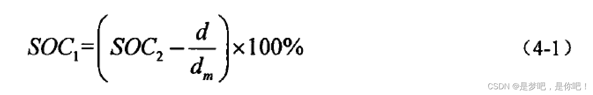
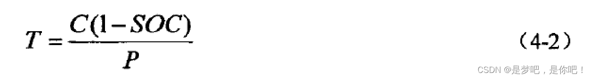
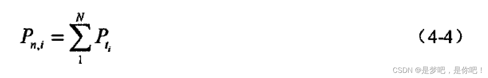
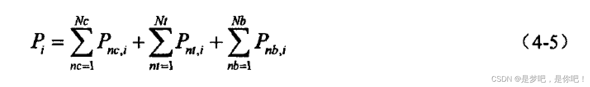
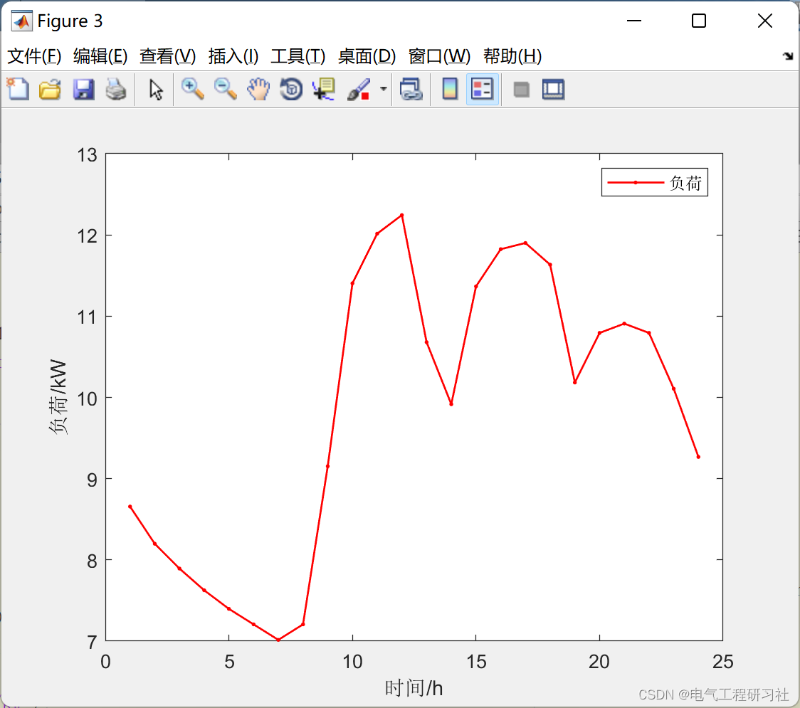
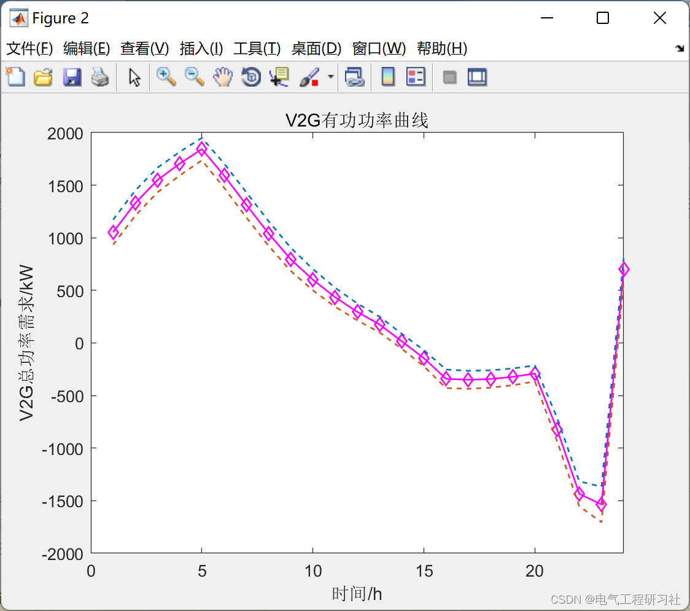
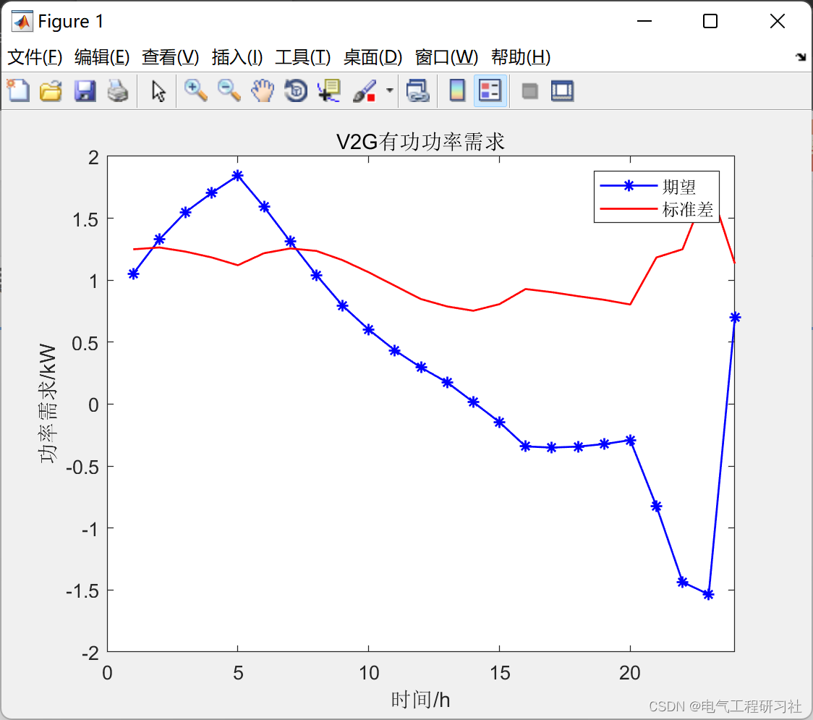

# Ordered Charging and Discharging of Electric Vehicles Based on Monte Carlo Simulation (Matlab Code Implementation)

Editor
1. Overview: Electric vehicles (EVs) are characterized by their clean and environmentally friendly features, as well as their high efficiency and energy-saving benefits. They not only mitigate the crisis of fossil fuels but also effectively reduce greenhouse gas emissions. In October 2015, the State Council issued guidelines to accelerate the construction of charging infrastructure for electric vehicles, stating that by 2020, the charging infrastructure should be able to meet the charging needs of 5 million EVs. It is expected that in the coming years, China's ownership of EVs will significantly increase.However, Unregulated charging of large-scale EVs will increase the peak-to-valley difference in the power grid load. And the planning of power system. The power quality and economic operation as well as stability of the distribution network bring significant impacts. Conversely, orderly optimize and control the charging behavior of EVs. Fully leverage the advantages of EVs as distributed energy storage components. Can achieve peak shaving and valley filling. The function of moderating the fluctuations in the output of renewable energy. And provide peak shaving for the power grid. Frequency modulation and other auxiliary services. This paper uses Monte Carlo simulation and Lagrange relaxation method to simulate the load curve of electric vehicle. At the same time, the power curve of unordered charging is solved. As a basis for comparing the charging curves.
2. Introduction to the Monte Carlo Simulation Method
The Monte Carlo method, also known as random sampling technique or statistical testing method, is a method based on probability statistics theory. With the development of science and technology and the invention of electronic computers, the Monte Carlo method has been widely applied in various fields due to its advantages in describing the characteristics of physical development and the process of physical experiments.
In my article, I will explain and provide code for the Monte Carlo method (random simulation method):
Monte Carlo Simulation Program Structure is very simple, with random numbers entering the formula to calculate the result. Although it does not have the best process, it is difficult to get satisfactory results when the simulation count is small. However, the Monte Carlo method can realistically simulate the process of actual problems, so it solves problems more practically. This is why Monte Carlo simulation is commonly used in transportation, mechanical simulation, physical experiments, etc.
The main use of Monte Carlo simulation is nested within the simulation model. Although it is not commonly used in competitions, it is often encountered in industrial production, where several schemes are proposed. At this time, different models and conditions can be used to obtain the distribution of results to evaluate the quality of the schemes.
In my article, I implement it using Matlab: Integer Programming Monte Carlo Simulation (Matlab implementation).
3. Large-scale Electric Vehicle Charging Load Forecast Based on Monte Carlo Method (Python & Matlab implementation)
4. (Matlab implementation) Based on Monte Carlo and Lagrange Multiplier Method for Electric Vehicle Scheduling [Orderly, Disordered Charging] (Matlab implementation)
5. Large-scale Electric Vehicle Charging Load Forecasting Computation Method After Researching the Principle and Model, assuming that all electric vehicles are in an orderly charging state, the specific calculation method is as follows:
(1) Calculate the initial charge state and the charging duration required for vehicles. The remaining battery capacity of electric vehicle power batteries directly affects the charging time required for electric vehicles. For the charging time required for electric vehicles, this article uses the State of Charge (SOC) of electric vehicle power batteries to calculate. Assuming that the consumed electricity is proportional to the distance traveled, it is set as the already traveled distance and the maximum range in electric mode. Here, it is assumed that the consumption of electricity per kilometer for each type of electric vehicle is the same. The remaining battery capacity at the end of the last trip is calculated by the following formula:
Editor
In the formula, SOC1 represents the battery's state of charge at the time of completing charging, and SOC2 represents the battery's state of charge at the time of the previous completion of charging.
The time required for electric vehicle charging, T, can be calculated by taking into account the battery capacity C, the initial state of charge SOC, and the charging power P.
Okay, the specific formula is as follows:
Editor
(2) Calculate the total charging load for a certain type of electric vehicle at each i-th charging load calculation point. This paper calculates daily as 1440 minutes, calculating the charging load every 15 minutes, with a total of 96 charging load calculation points. It predicts the charging loads for electric vehicles in various uses in Beijing and obtains the charging loads for electric vehicles in various uses. The prediction calculation method for the charging load of a certain type of electric vehicle is as follows:
Editor
The editor indicates the moment when the nth electric vehicle of a certain purpose has finished charging. Editor indicates the moment when the nth electric vehicle of a certain purpose starts charging. T represents the charging time required for a certain type of electric vehicle with n applications. The total charging load of a certain type of electric vehicle at the i-th charging load calculation point can be calculated by the following method.
Editor
The editor indicates the charging load of the nth electric vehicle at the i-th charging load calculation point, where N represents the ownership count of electric vehicles for a certain purpose.
(3) The total electric vehicle charging load is obtained by superimposing the charging loads of various types of electric vehicles. The calculation method for the total electric vehicle charging load at the i-th charging load calculation point is shown in formula (4-6):  
​Edit  
In this formula, Nc, Nt, and Nb represent the number of electric private cars, electric taxis, and electric buses that are charging at the i-th moment, respectively; ​Edit, ​Edit, and ​Edit represent the charging loads of electric private cars, electric taxis, and electric buses at the i-th moment, respectively.  
6 Simulation results  
​Edit  
​Edit  
7 Matlab code implementation - This paper only presents a part of the code, all codes can be found here:
Load=xlsread('Data.xls')\nfor i=1:1:5000\n    S=20+10*rand(1);% Capacity\n    P=rand(1)+2;%Charging power\n    finish(i,1)=17.6+3.4*randn(1);% Final departure time\n    if finish(i,1)>24\n        finish(i,1)=finish(i,1)-24;\n    end\n    while(finish(i,1)<0)\n        finish(i,1)=17.6+3.4*randn(1);\n    end\n    finish(i,1)=ceil(finish(i,1));\n    distance(i,1)=lognrnd(3.2,0.88);\n    while(distance(i,1)>160/1.61)\n        distance(i,1)=lognrnd(3.2,0.88);% Daily mileage\n    end\n    %% Discharge\n    temp=9*rand(1);\n    if (temp<=6)\n        disch(i,1)=10+temp;\n    else\n        disch(i,1)=20-6+temp;\n    end\n  
​  

## Images

<!-- PAYMENT_BLOCK -->

## Get this dataset

- Payment link (Stripe): [Buy now](https://buy.stripe.com/3cs8yP7sY87d0vu9AB)
- Payment QR code: 

<!-- /PAYMENT_BLOCK -->
